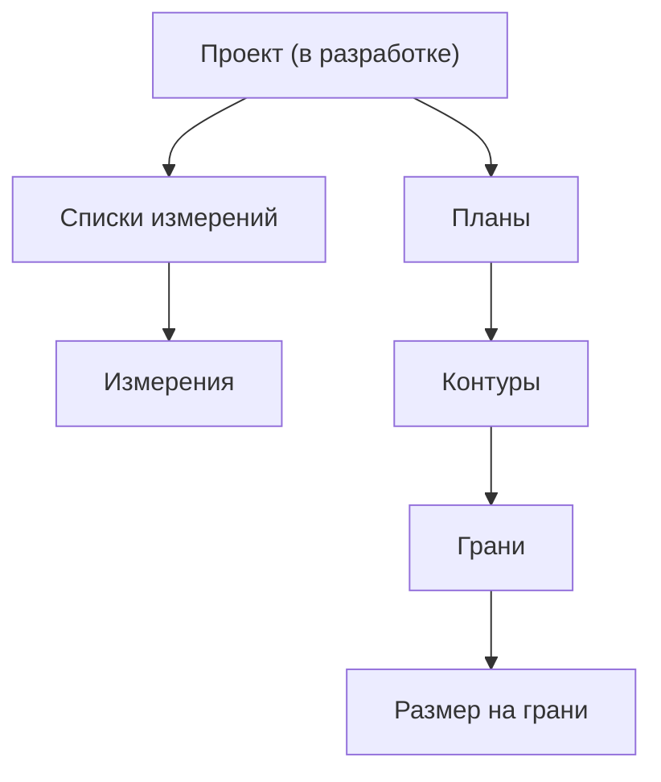

# Доменная модель и хранение объектов учёта

Документ описывает, из чего состоят объекты учёта приложения, как они лежат на диске и какие
инварианты нельзя нарушать. Причины решений — в ADR: формат документов в
[0002](adr/0002-local-json-documents-for-measurement-lists.md) и
[0004](adr/0004-store-plans-as-local-json-documents.md), размеры на гранях —
[0007](adr/0007-plan-dimensions-on-edges.md), единицы — [0009](adr/0009-canonical-lengths-and-document-units.md).

## Общая схема

Сейчас объектов учёта два: **список измерений** и **план**. Проект, который объединит их, ещё не
реализован; на схеме он показан как будущий владелец.



Каждый объект учёта — **отдельный JSON-документ**. Ссылок между документами нет: список не знает о
плане, план не знает о списке. Это позволяет открывать, переименовывать и удалять объекты независимо.

## Файлы на устройстве

| Объект | Каталог | Имя файла |
|---|---|---|
| Список измерений | `filesDir/measurements/` | `<uuid>.json` |
| План | `filesDir/plans/` | `<uuid>.json` |

- Имя объекта хранится внутри документа, а не в имени файла: переименование не трогает файл.
- Идентификатор документа — UUID и совпадает с именем файла. При чтении это проверяется, поэтому
  случайно переименованный или недописанный файл не будет принят за другой документ.
- Запись атомарная: временный файл → `fsync` → переименование. Предыдущая версия остаётся в
  `<uuid>.json.bak` и читается, если основной файл повреждён.
- Каждое изменение сохраняется сразу, отдельной кнопки «Сохранить» нет.

## Длина и единицы

Все длины внутри приложения хранятся в **каноническом виде**: строка миллиметров с точностью до
шести знаков после запятой. Единица измерения — свойство документа (`unit`), а не отдельного
значения. Она задаёт только то, как длина показывается и сколько знаков после запятой принимает
ручной ввод.

| Единица | Коэффициент в мм | Знаков при показе |
|---|---|---|
| `METERS` (`м`) | 1000 | 3 |
| `CENTIMETERS` (`см`) | 10 | 1 |
| `MILLIMETERS` (`мм`) | 1 | 1 |
| `FEET` (`ft`) | 304.8 | 4 |
| `INCHES` (`in`) | 25.4 | 4 |

Правила:

- Дальномер отдаёт значение в своей единице; при сохранении оно переводится в миллиметры и больше
  не зависит от режима прибора.
- Ручной ввод проверяется в единице документа. Больше знаков, чем показывает единица, ввести нельзя.
- Смена единицы меняет одно поле документа. Значения не пересчитываются и не перезаписываются,
  поэтому переключение туда-обратно не накапливает погрешность.
- При показе значение округляется по таблице; при следующей смене единицы используется исходное
  точное значение из файла.
- Если поле ввода не редактировали, сохранение оставляет точное значение, а не его округлённый показ.
- Миллиметры — единственная каноническая единица. Дюймы и футы переводятся десятичными
  коэффициентами, а не двоичными числами.

## Список измерений

`MeasurementList` — именованный набор измерений с одной единицей на весь список.

| Поле | Смысл |
|---|---|
| `schemaVersion` | Версия формата; сейчас `2` |
| `id` | UUID документа |
| `name` | Имя списка, видимое пользователю |
| `unit` | Единица показа всех измерений списка |
| `createdAt`, `updatedAt` | Время создания и последнего изменения, epoch ms |
| `measurements` | Массив измерений |

`Measurement` — одно значение.

| Поле | Смысл |
|---|---|
| `id` | UUID измерения |
| `valueMm` | Каноническая длина в миллиметрах |
| `comment` | Комментарий пользователя, может быть пустым |
| `createdAt` | Когда измерение добавлено, epoch ms |
| `source` | `MANUAL` или `RANGFINDER` |

Порядок в файле — порядок добавления. Экран показывает свежие сверху, сортировка не меняет файл.

```json
{
  "schemaVersion": 2,
  "id": "0f0b4a2e-6a1c-4a63-9a3e-1b2c3d4e5f60",
  "name": "Гостиная",
  "unit": "CENTIMETERS",
  "createdAt": 1730000000000,
  "updatedAt": 1730000100000,
  "measurements": [
    {
      "id": "6b1d2c3e-7f80-4a91-b2c3-d4e5f6071829",
      "valueMm": "1763",
      "comment": "Ширина окна",
      "createdAt": 1730000050000,
      "source": "RANGFINDER"
    }
  ]
}
```

## План

`PlanDocument` — именованный чертёж. Координаты — абстрактные единицы сетки, а не пиксели, поэтому
план одинаково выглядит на разных экранах и в разной ориентации. Реального масштаба у чертежа пока
нет: размеры — пометки на стенах, а не источник геометрии.

| Поле | Смысл |
|---|---|
| `schemaVersion` | Версия формата; сейчас `4` |
| `id` | UUID документа |
| `name` | Имя плана |
| `unit` | Единица показа всех размеров плана |
| `createdAt`, `updatedAt` | Время создания и последнего изменения, epoch ms |
| `world` | Размер листа в единицах сетки |
| `nodes` | Узлы чертежа |
| `contours` | Контуры (цепочки соединённых граней) |

`PlanSize` — лист, прямоугольник от начала координат.

| Поле | Смысл |
|---|---|
| `width`, `height` | Ширина и высота листа в единицах сетки; по умолчанию `20 × 28` |

Лист растёт при рисовании и хранится в документе. Зум и сдвиг вида в файл не попадают: при открытии
план снова вписывается в экран.

`PlanNode` — точка чертежа.

| Поле | Смысл |
|---|---|
| `id` | UUID узла |
| `x`, `y` | Координаты в единицах сетки |

Узлы, поставленные рисованием и перетаскиванием, лежат на сетке. Узел, вставленный на стену, хранит
точную проекцию касания и может иметь дробные координаты при любом наклоне стены: привязка к сетке
сдвинула бы метку от места касания, а наклонную стену ещё и изогнула бы
([0010](adr/0010-split-plan-edges-to-add-points.md)).

`PlanContour` — упорядоченная цепочка граней.

| Поле | Смысл |
|---|---|
| `id` | UUID контура |
| `edges` | Грани по порядку |

`isClosed` не хранится: контур замкнут, если последняя грань возвращается в начальный узел.

`PlanEdge` — одна стена.

| Поле | Смысл |
|---|---|
| `id` | UUID грани |
| `startNodeId`, `endNodeId` | Концы грани |
| `dimension` | Размер на грани или `null` |

Идентификатор у грани существует именно ради размера: по координатам нельзя отличить одну стену от
другой после правки формы.

Точка, вставленная на грань, делит её: `PlanEditing.splitEdge` заменяет ребро двумя соседними в той
же позиции контура. Первая половина сохраняет `id` исходной грани, вторая получает новый, а обе
теряют размер. Новый узел остаётся на точной проекции касания и может иметь дробные координаты.
Лист не растёт, форма стены не меняется.

`PlanDimension` — расстояние, прикреплённое к грани.

| Поле | Смысл |
|---|---|
| `valueMm` | Каноническая длина в миллиметрах |
| `source` | `MANUAL` или `RANGFINDER` |
| `updatedAt` | Когда размер изменён, epoch ms |

Размер не меняет координаты и не включает масштаб. При перемещении грани идентификатор сохраняется,
и размер «переезжает» вместе со стеной; при удалении грани удаляется и её размер.

```json
{
  "schemaVersion": 4,
  "id": "2b3c4d5e-6f70-4a81-b2c3-d4e5f6071829",
  "name": "Гостиная",
  "unit": "METERS",
  "createdAt": 1730000000000,
  "updatedAt": 1730000200000,
  "world": { "width": 20.0, "height": 28.0 },
  "nodes": [
    { "id": "a1", "x": 2.0, "y": 2.0 },
    { "id": "a2", "x": 8.0, "y": 2.0 }
  ],
  "contours": [
    {
      "id": "c1",
      "edges": [
        {
          "id": "e1",
          "startNodeId": "a1",
          "endNodeId": "a2",
          "dimension": {
            "valueMm": "3200",
            "source": "MANUAL",
            "updatedAt": 1730000150000
          }
        }
      ]
    }
  ]
}
```

## Что не хранится

- Зум, сдвиг и вписанный вид плана — состояние редактора, а не документа.
- История отмены плана — живёт в памяти и начинается заново при открытии плана.
- Состояние подключения дальномера и признак паузы записи — сессия, а не данные.
- Последняя выбранная единица — удобство приложения; она влияет только на единицу новых документов.

## Версии и совместимость

- `schemaVersion` каждой сущности повышается при изменении формы документа.
- Поля, появившиеся позже, имеют значения по умолчанию, поэтому старый документ без них читается:
  у плана без `unit` единица — метры.
- Версии 1 списков и версии 1–3 планов содержали единицу на каждом значении. Миграции нет: приложение
  ещё в разработке, тестовые данные очищены. Документ без `valueMm` считается нечитаемым.
- `ignoreUnknownKeys` позволяет новой версии приложения добавлять поля, не ломая чтение старых
  документов. Удаление или переименование обязательного поля требует явной миграции.

## Инварианты

1. Все длины в документах — миллиметры в десятичной строке; единица документа на значения не влияет.
2. У списка измерений одна единица на весь список, у плана — одна на все размеры.
3. Координаты плана — единицы сетки, а не пиксели и не миллиметры.
4. Идентификаторы документов, узлов, граней, контуров и измерений уникальны и не переиспользуются.
5. Размер принадлежит грани и хранится в её поле; отдельного списка размеров нет.
6. Удаление узла без граней и грани без контура не оставляет «висячих» записей.
7. Любая правка сразу пишется на диск атомарно; предыдущая версия остаётся в `.bak`.
8. Вьюмодели и экраны не знают о JSON: доступ идёт через `MeasurementListRepository` и
   `PlanRepository`.
9. Вставленный на грань узел лежит на ней; его координаты могут быть дробными, но форма грани не
   меняется.
