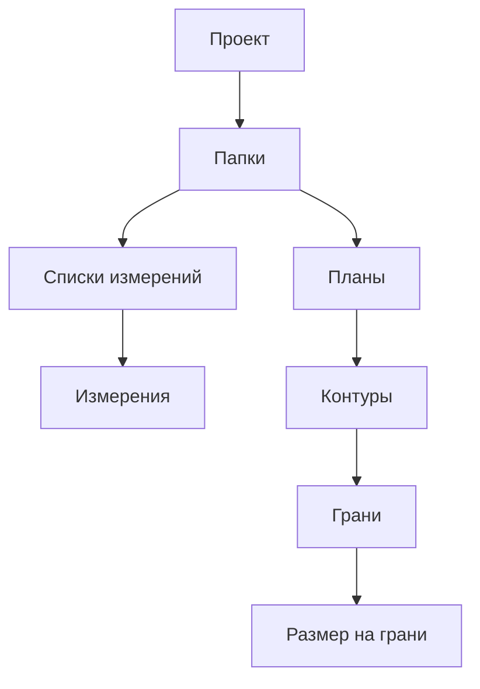

# Доменная модель и хранение объектов учёта

Документ описывает, из чего состоят объекты учёта приложения, как они лежат на диске и какие
инварианты нельзя нарушать. Причины решений — в ADR: формат документов в
[0002](adr/0002-local-json-documents-for-measurement-lists.md) и
[0004](adr/0004-store-plans-as-local-json-documents.md), размеры на гранях —
[0007](adr/0007-plan-dimensions-on-edges.md), единицы — [0009](adr/0009-canonical-lengths-and-document-units.md),
проекты — [0015](adr/0015-projects-as-reference-trees.md).

## Общая схема

Сейчас объектов учёта три: **список измерений**, **план** и **проект**. Проект — организационный
слой: он показывает дерево папок и ссылается на списки и планы, но не владеет их содержимым.



Каждый объект учёта — **отдельный JSON-документ**. Список не знает о плане, план не знает о
списке, и ни один из них не знает о проекте. Ссылки хранит только проект: он ссылается на объекты
по виду и идентификатору. Поэтому объект можно открыть, переименовать и удалить независимо, а
проект можно удалить, не трогая данные. Объект может лежать в папке или прямо в корне проекта.

## Файлы на устройстве

| Объект | Каталог | Имя файла |
|---|---|---|
| Список измерений | `filesDir/measurements/` | `<uuid>.json` |
| План | `filesDir/plans/` | `<uuid>.json` |
| Проект | `filesDir/projects/` | `<uuid>.json` |

- Имя объекта хранится внутри документа, а не в имени файла: переименование не трогает файл.
- Идентификатор документа — UUID и совпадает с именем файла. При чтении это проверяется, поэтому
  случайно переименованный или недописанный файл не будет принят за другой документ.
- Запись атомарная: временный файл → `fsync` → переименование. Предыдущая версия остаётся в
  `<uuid>.json.bak` и читается, если основной файл повреждён.
- Каждое изменение сохраняется сразу, отдельной кнопки «Сохранить» нет.

## Длина и единицы

Все длины внутри приложения хранятся в **каноническом виде**: строка миллиметров с точностью до
шести знаков после запятой. Единица измерения — свойство документа (`unit`), а не отдельного
значения. Она задаёт только то, как длина показывается и сколько знаков после запятой принимает
ручной ввод.

| Единица | Коэффициент в мм | Знаков при показе |
|---|---|---|
| `METERS` (`м`) | 1000 | 3 |
| `CENTIMETERS` (`см`) | 10 | 1 |
| `MILLIMETERS` (`мм`) | 1 | 1 |
| `FEET` (`ft`) | 304.8 | 4 |
| `INCHES` (`in`) | 25.4 | 4 |

Правила:

- Дальномер отдаёт значение в своей единице; при сохранении оно переводится в миллиметры и больше
  не зависит от режима прибора.
- Ручной ввод проверяется в единице документа. Больше знаков, чем показывает единица, ввести нельзя.
- Смена единицы меняет одно поле документа. Значения не пересчитываются и не перезаписываются,
  поэтому переключение туда-обратно не накапливает погрешность.
- При показе значение округляется по таблице; при следующей смене единицы используется исходное
  точное значение из файла.
- Если поле ввода не редактировали, сохранение оставляет точное значение, а не его округлённый показ.
- Миллиметры — единственная каноническая единица. Дюймы и футы переводятся десятичными
  коэффициентами, а не двоичными числами.

## Список измерений

`MeasurementList` — именованный набор измерений с одной единицей на весь список.

| Поле | Смысл |
|---|---|
| `schemaVersion` | Версия формата; сейчас `2` |
| `id` | UUID документа |
| `name` | Имя списка, видимое пользователю |
| `unit` | Единица показа всех измерений списка |
| `createdAt`, `updatedAt` | Время создания и последнего изменения, epoch ms |
| `measurements` | Массив измерений |

`Measurement` — одно значение.

| Поле | Смысл |
|---|---|
| `id` | UUID измерения |
| `valueMm` | Каноническая длина в миллиметрах |
| `comment` | Комментарий пользователя, может быть пустым |
| `createdAt` | Когда измерение добавлено, epoch ms |
| `source` | `MANUAL` или `RANGFINDER` |

Порядок в файле — порядок добавления. Экран показывает свежие сверху, сортировка не меняет файл.

```json
{
  "schemaVersion": 2,
  "id": "0f0b4a2e-6a1c-4a63-9a3e-1b2c3d4e5f60",
  "name": "Гостиная",
  "unit": "CENTIMETERS",
  "createdAt": 1730000000000,
  "updatedAt": 1730000100000,
  "measurements": [
    {
      "id": "6b1d2c3e-7f80-4a91-b2c3-d4e5f6071829",
      "valueMm": "1763",
      "comment": "Ширина окна",
      "createdAt": 1730000050000,
      "source": "RANGFINDER"
    }
  ]
}
```

## План

`PlanDocument` — именованный чертёж. Координаты — абстрактные единицы сетки, а не пиксели, поэтому
план одинаково выглядит на разных экранах и в разной ориентации. Реальный масштаб появляется вместе с
первым размером: он задаёт соотношение единиц и миллиметров, и дальше чертёж подгоняется под размеры
([0012](adr/0012-bind-plan-dimensions-to-geometry.md)).

| Поле | Смысл |
|---|---|
| `schemaVersion` | Версия формата; сейчас `7` |
| `id` | UUID документа |
| `name` | Имя плана |
| `unit` | Единица показа всех размеров плана |
| `createdAt`, `updatedAt` | Время создания и последнего изменения, epoch ms |
| `world` | Размер листа в единицах сетки |
| `mmPerUnit` | Миллиметров на единицу сетки; `null`, пока масштаба нет |
| `scaleEdgeId` | Грань, чей размер задал масштаб |
| `nodes` | Узлы чертежа |
| `contours` | Контуры (цепочки соединённых граней) |
| `calculations` | Сохранённые расчёты площади и длины |

`mmPerUnit` — соотношение, а не длина, и оно хранится, а не выводится из самого старого размера:
иначе удаление одной стены пересчитывало бы масштаб и перестраивало весь план.
`scaleEdgeId` позволяет перенести масштаб на новое значение, когда пользователь перемеряет именно эту
стену; если грань теряет размер, поле становится `null`, а `mmPerUnit` остаётся.

`PlanSize` — лист, прямоугольник от начала координат.

| Поле | Смысл |
|---|---|
| `width`, `height` | Ширина и высота листа в единицах сетки; по умолчанию `200 × 280` |

Размер листа по умолчанию задаёт разрешение чертежа: комната, нарисованная на весь холст,
занимает около 200 единиц, поэтому мельчайший элемент — около 0,5 % стены. Шаг роста листа — 20
единиц. Зум расширяет только показ и мелкую сетку, но не дробит шаг привязки
([0011](adr/0011-plan-grid-resolution.md)).

Лист растёт при рисовании, а после ввода размера и при открытии масштабированного плана подрезается
к чертежу и центрируется на нём, и хранится в документе
([0014](adr/0014-trim-plan-sheet-after-scaling.md)). Зум и сдвиг вида в файл не попадают: при
открытии план снова вписывается в экран.

`PlanNode` — точка чертежа.

| Поле | Смысл |
|---|---|
| `id` | UUID узла |
| `x`, `y` | Координаты в единицах сетки |

Узлы, поставленные рисованием и перетаскиванием, лежат на сетке. Узел, вставленный на стену, хранит
точную проекцию касания и может иметь дробные координаты при любом наклоне стены: привязка к сетке
сдвинула бы метку от места касания, а наклонную стену ещё и изогнула бы
([0010](adr/0010-split-plan-edges-to-add-points.md)). После подгонки под размеры дробными становятся
и остальные узлы: чертёж масштабируется, а сетка остаётся только ориентиром.

`PlanContour` — упорядоченная цепочка граней.

| Поле | Смысл |
|---|---|
| `id` | UUID контура |
| `edges` | Грани по порядку |

`isClosed` не хранится: контур замкнут, если последняя грань возвращается в начальный узел.

`PlanEdge` — одна стена.

| Поле | Смысл |
|---|---|
| `id` | UUID грани |
| `startNodeId`, `endNodeId` | Концы грани |
| `dimension` | Размер на грани или `null` |

Идентификатор у грани существует именно ради размера: по координатам нельзя отличить одну стену от
другой после правки формы.

Точка, вставленная на грань, делит её: `PlanEditing.splitEdge` заменяет ребро двумя соседними в той
же позиции контура. Первая половина сохраняет `id` исходной грани, вторая получает новый, а обе
теряют размер. Новый узел остаётся на точной проекции касания и может иметь дробные координаты.
Лист не растёт, форма стены не меняется.

`PlanDimension` — расстояние, прикреплённое к грани.

| Поле | Смысл |
|---|---|
| `valueMm` | Каноническая длина в миллиметрах |
| `source` | `MANUAL` или `RANGFINDER` |
| `updatedAt` | Когда размер изменён, epoch ms |

Размер даёт плану масштаб: при вводе значения чертёж подгоняется так, чтобы стена стала такой длины в
единицах сетки, при этом направления граней не меняются. Замкнутый контур сохраняет `m − 2` свободных
длин, поэтому размеры, которые углы удержать не могут, остаются подписями, а расхождение с чертежом
видно по цвету стены и знаку `≈` у подписи. При перемещении грани идентификатор сохраняется, и размер
«переезжает» вместе со стеной; при удалении грани удаляется и её размер
([0012](adr/0012-bind-plan-dimensions-to-geometry.md)).

`PlanCalculation` — сохранённый пользователем расчёт.

| Поле | Смысл |
|---|---|
| `id` | UUID расчёта |
| `name` | Имя, заданное пользователем |
| `kind` | `AREA` или `LENGTH` |
| `contourId` | Устаревшая ссылка на контур; новые расчёты площади её не используют |
| `edgeIds` | Рёбра замкнутого цикла для площади или выбранные рёбра для длины |
| `subtractHoles` | Вычитать ли вложенные циклы |
| `createdAt` | Когда расчёт сохранён, epoch ms |
| `comment` | Комментарий пользователя; пустая строка, если его нет |

Число не хранится: `PlanMeasurements` выводит площадь, периметр и длину из текущей геометрии и
`mmPerUnit` ([0020](adr/0020-plan-calculations-from-geometry.md)). Площадь считается по замкнутому
циклу рёбер, который выводится из графа: поэтому прямоугольник, нарисованный двумя цепочками от
одного угла до другого, тоже считается. Вырезом считается другой цикл, целиком лежащий внутри
выбранного и не касающегося его; касающиеся и пересекающиеся циклы не вычитаются. Расчёт обновляет
ссылки, когда грань делят точкой; разрыв цикла делает расчёт площади недоступным, но не удаляет его.
Комментарий — свободный текст пользователя; он не влияет на вычисления и переживает правку формы.

```json
{
  "schemaVersion": 7,
  "id": "2b3c4d5e-6f70-4a81-b2c3-d4e5f6071829",
  "name": "Гостиная",
  "unit": "METERS",
  "createdAt": 1730000000000,
  "updatedAt": 1730000200000,
  "world": { "width": 200.0, "height": 280.0 },
  "mmPerUnit": 533.333333,
  "scaleEdgeId": "e1",
  "nodes": [
    { "id": "a1", "x": 2.0, "y": 2.0 },
    { "id": "a2", "x": 8.0, "y": 2.0 }
  ],
  "contours": [
    {
      "id": "c1",
      "edges": [
        {
          "id": "e1",
          "startNodeId": "a1",
          "endNodeId": "a2",
          "dimension": {
            "valueMm": "3200",
            "source": "MANUAL",
            "updatedAt": 1730000150000
          }
        }
      ]
    }
  ],
  "calculations": []
}
```

## Проект

`ProjectDocument` — именованное дерево папок и ссылок на списки измерений и планы. Проект не
хранит ни измерений, ни геометрии: он только группирует существующие документы
([0015](adr/0015-projects-as-reference-trees.md)).

| Поле | Смысл |
|---|---|
| `schemaVersion` | Версия формата; сейчас `1` |
| `id` | UUID документа |
| `name` | Имя проекта |
| `createdAt`, `updatedAt` | Время создания и последнего изменения, epoch ms |
| `folders` | Папки дерева |
| `objects` | Ссылки на списки измерений и планы |

`ProjectFolder` — папка дерева.

| Поле | Смысл |
|---|---|
| `id` | UUID папки |
| `name` | Имя папки |
| `parentId` | Родительская папка; `null` — корень проекта |

`ProjectObjectRef` — ссылка на объект.

| Поле | Смысл |
|---|---|
| `kind` | `MEASUREMENT_LIST` или `PLAN` |
| `refId` | UUID списка измерений или плана |
| `folderId` | Папка; `null` — корень проекта |

Имя объекта в ссылке не хранится: оно берётся из живого документа, поэтому переименование сразу
видно в дереве. Один объект может быть не более чем в одном проекте; при добавлении в другой проект
ссылка уходит из прежнего. Удаление проекта удаляет только дерево, а удаление папки поднимает её
объекты на уровень выше; измерения и планы при этом не удаляются. Ссылка на уже удалённый объект не
показывается и не считается в счётчиках. При удалении списка или плана его ссылки убираются из всех
проектов; старые ссылки удаляются вручную из меню проекта и только тогда, когда файла объекта больше
нет. Автоматически чистить ссылки по одному отсутствию в живых списках нельзя: временный сбой чтения
выглядел бы как удаление (ADR 0017). Порядок строк в дереве не хранится: он алфавитный, а
перетаскивание меняет только родителя папки или объекта (ADR 0018).

```json
{
  "schemaVersion": 1,
  "id": "7c8d9e0f-1a2b-4c3d-8e4f-5a6b7c8d9e0f",
  "name": "Квартира на Ленина",
  "createdAt": 1730000000000,
  "updatedAt": 1730000300000,
  "folders": [
    { "id": "f1", "name": "Гостиная", "parentId": null }
  ],
  "objects": [
    { "kind": "MEASUREMENT_LIST", "refId": "0f0b4a2e-6a1c-4a63-9a3e-1b2c3d4e5f60", "folderId": "f1" },
    { "kind": "PLAN", "refId": "2b3c4d5e-6f70-4a81-b2c3-d4e5f6071829", "folderId": null }
  ]
}
```

## Что не хранится

- Зум, сдвиг и вписанный вид плана — состояние редактора, а не документа.
- Признак расхождения размера с чертежом — вычисляется из координат и масштаба, поэтому не хранится и
  исчезает, когда чертёж снова сходится со значением.
- Значение сохранённого расчёта — выводится из геометрии и масштаба; в документе лежит только
  определение, что именно считать.
- История отмены плана — живёт в памяти и начинается заново при открытии плана.
- Раскрытие папок и положение в дереве проекта — состояние экрана, а не документа.
- Состояние подключения дальномера и признак паузы записи — сессия, а не данные.
- Последняя выбранная единица — удобство приложения; она влияет только на единицу новых документов.

## Версии и совместимость

- `schemaVersion` каждой сущности повышается при изменении формы документа.
- Поля, появившиеся позже, имеют значения по умолчанию, поэтому старый документ без них читается:
  у плана без `unit` единица — метры.
- Версии 1 списков и версии 1–3 планов содержали единицу на каждом значении. Миграции нет: приложение
  ещё в разработке, тестовые данные очищены. Документ без `valueMm` считается нечитаемым.
- У проекта своя `schemaVersion`; сейчас `1`. Ссылки на удалённые объекты миграции не требуют: они
  не показываются, а чистятся при удалении объекта или вручную.
- `ignoreUnknownKeys` позволяет новой версии приложения добавлять поля, не ломая чтение старых
  документов. Удаление или переименование обязательного поля требует явной миграции.
- План версии 6 и раньше читается без миграции: `calculations` по умолчанию пуст, а у расчёта без
  `comment` комментарий пуст.

## Инварианты

1. Все длины в документах — миллиметры в десятичной строке; единица документа на значения не влияет.
2. У списка измерений одна единица на весь список, у плана — одна на все размеры.
3. Координаты плана — единицы сетки, а не пиксели и не миллиметры; миллиметры живут только в размерах
   и в масштабе.
4. Идентификаторы документов, узлов, граней, контуров, измерений, проектов и папок уникальны и не переиспользуются.
5. Размер принадлежит грани и хранится в её поле; отдельного списка размеров нет.
6. Удаление узла без граней и грани без контура не оставляет «висячих» записей.
7. Любая правка сразу пишется на диск атомарно; предыдущая версия остаётся в `.bak`.
8. Вьюмодели и экраны не знают о JSON: доступ идёт через `MeasurementListRepository`,
   `PlanRepository` и `ProjectRepository`.
9. Вставленный на грань узел лежит на ней; его координаты могут быть дробными, но форма грани не
   меняется.
10. `mmPerUnit` есть тогда и только тогда, когда в плане есть хотя бы один размер; `scaleEdgeId`
    указывает на грань с размером или равен `null`.
11. Проект хранит только ссылки на списки и планы; сами объекты о проекте не знают.
12. Один объект входит не более чем в один проект.
13. Удаление проекта или папки не удаляет списки и планы: у проекта ссылка исчезает, у папки её
    объекты поднимаются на уровень выше, а документы остаются.
14. Ссылка на отсутствующий документ не показывается и не удаляет данные; автоматически чистить её
    нельзя, чтобы сбой чтения не стёр ссылки. Удаление объекта убирает ссылки во всех проектах, а
    ручная чистка трогает только ссылки без файла документа.
15. Расчёт ссылается на существующие рёбра. Замкнутый цикл выводится из графа, а не только из
    цепочки контура; разрыв цикла делает расчёт площади недоступным, но не стирает его. Удаление
    грани убирает её из расчётов, а очистка чертежа удаляет все расчёты.
