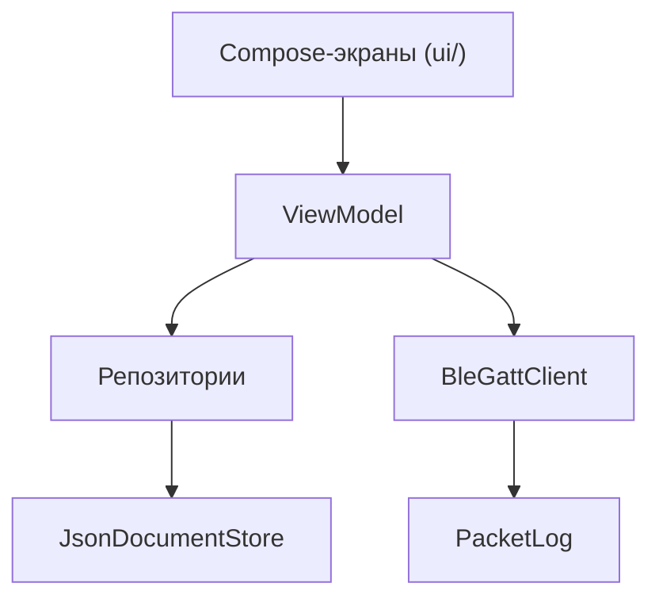

# Обзор проекта

Краткое введение в `Plan & Measure`: зачем он нужен, как устроен и с чего начинать чтение кода. Правила работы с репозиторием — в `AGENTS.md`, причины архитектурных решений — в `docs/adr/`.

## Назначение и пользователь

`Plan & Measure` — инструмент быстрых замеров. Приложение помогает промерить уже построенное помещение, с лазерным дальномером или вручную, и сразу сохранить результат, чтобы посчитать объём работ и материалов.

Это не BIM и не CAD. Приложение не создаёт архитектурный проект, а решает обратную задачу: перенести в цифру размеры готового объекта, который заказчик уже построил по чужому проекту.

Целевой пользователь — мастер отделки, установщик окон и дверей, человек, которому нужно быстро снять размеры у заказчика. Он не проектировщик и не станет разбираться в сложном профессиональном инструменте. Отсюда принципы продукта:

- главный сценарий — замер; дальномер ускоряет его, но не обязателен;
- минимум шагов и настроек, интерфейс понятен без обучения;
- план — эскиз для расчёта, а не чертёж для строительства;
- новая возможность должна окупать усложнение; если задача решается проще, выбирается проще;
- данные хранятся локально, без аккаунтов и сервера.

## Что уже работает

- **Измерения** — именованные списки с комментариями и ручной правкой; одна единица на список; значения приходят вручную или с дальномера.
- **Планы** — контур помещения рисуется пальцем на сетке, правится и сохраняется; размеры ставятся на стены, вводятся вручную или принимаются с дальномера, а по ним план получает реальный масштаб.
- **Проекты** — дерево папок, объединяющее существующие списки измерений и планы; объекты можно добавлять, переносить и исключать, не меняя сами документы. Строку можно перетащить долгим нажатием, но порядок внутри папки остаётся алфавитным.
- **BLE Lab** — рабочий инструмент исследования протокола Instrumax: сканирование, GATT-дерево, журнал и экспорт.
- **Настройки** — тема, язык, раскладка дерева проектов и глобальный охват объектов («Все / Без проекта») для разделов; тема и язык фиксируются при первом запуске.

## Стек

Kotlin, Jetpack Compose, Material 3, MVVM. `minSdk 24`, `compileSdk 34`, `targetSdk 34`. Хранение — `kotlinx.serialization` в локальных JSON-документах. Подробности сборки — в `README.md`.

## Архитектура

- Экраны Compose не работают с хранилищем и `BluetoothGatt` напрямую: состояние принадлежит ViewModel, доступ к данным — репозиториям.
- `LabViewModel` — единственный владелец BLE-сессии. Наружу он отдаёт состояние соединения и поток уже декодированных кадров.
- `MeasurementsViewModel` и `MeasurementListRepository` владеют списками измерений.
- `PlansViewModel` и `PlanRepository` владеют планами и открытым чертежом. Геометрия и правки — чистые функции `PlanGeometry` и `PlanEditing` с юнит-тестами; привязка размеров к геометрии — `PlanScale`.
- `ProjectsViewModel` и `ProjectRepository` владеют проектами и открытым деревом. Проект хранит только папки и ссылки на списки и планы; дерево собирает чистая функция `ProjectTree` с юнит-тестами, а цели перетаскивания проверяет `ProjectTreeDrag`. Объекты остаются независимыми документами (`docs/adr/0015-projects-as-reference-trees.md`, `docs/adr/0018-drag-project-tree-rows.md`).
- `SettingsViewModel` и `SettingsStorage` владеют темой, языком, раскладкой дерева проектов и глобальным охватом объектов для разделов.
- Верхнеуровневая навигация живёт в `ui/AppRoot.kt` и хранится в `rememberSaveable`, а не во ViewModel.

### Данные

- Списки измерений и планы — отдельные JSON-документы в `filesDir/measurements/` и `filesDir/plans/`.
- Проекты — отдельные JSON-документы в `filesDir/projects/`: дерево папок и ссылки на объекты, без копирования их содержимого.
- Запись атомарная, предыдущая версия остаётся в `.bak`; отдельной кнопки «Сохранить» нет.
- Все длины хранятся канонически в миллиметрах десятичной строкой; единица принадлежит документу и задаёт только показ и точность ввода.
- `allowBackup = false`: при переустановке данные теряются.

Форматы и инварианты — `docs/domain-model.md`; причины — ADR 0002, 0004, 0007, 0009, 0015.

### Планы

- Координаты — абстрактные единицы сетки, а не пиксели и не миллиметры.
- Лист плана хранится в документе и растёт по мере рисования, а после ввода размера и при открытии масштабированного плана подрезается к чертежу и центрирует его; зум и сдвиг вида живут в редакторе и в файл не попадают.
- Первый размер задаёт масштаб плана — миллиметров на единицу сетки. Каждый следующий перестраивает чертёж под себя, не меняя направлений граней; размеры, которые углы удержать не могут, остаются подписями и помечаются `≈`.
- Признак расхождения размера с чертежом не хранится: он вычисляется из координат и масштаба. Такая стена рисуется цветом ошибки, а у подписи появляется `≈`.
- Вставка точки на стену делит грань на две независимые (`PlanEditing.splitEdge`).

Причины — ADR 0004, 0005, 0006, 0010, 0011, 0012, 0014.

### Проекты

- Проект — дерево папок и ссылок на существующие списки измерений и планы. Имена объектов берутся из живых документов, поэтому переименование сразу видно в дереве.
- Один объект входит не более чем в один проект; при добавлении в другой проект ссылка уходит из прежнего, а сам документ не меняется.
- Удаление проекта удаляет только дерево, удаление папки поднимает объекты на уровень выше; измерения и планы не удаляются.
- Вложенные в проект объекты по умолчанию скрыты из разделов охватом «Без проекта»; с охватом «Все» они остаются видны там же с меткой проекта. Общая настройка не меняет проекты.
- Дерево проекта — один экран с раскрывающимися папками. Раскладка переключается в настройках: вложенные карточки с направляющими (по умолчанию) или плашки-заголовки групп; обе рисуют одни и те же данные. Перетаскивание меняет только папку-родителя, а порядок внутри папки остаётся алфавитным (`docs/adr/0018-drag-project-tree-rows.md`).
- Строку объекта можно полностью удалить: файл списка или плана и ссылки на него во всех проектах. «Исключить из проекта» удаляет только ссылку.
- Ссылки на объекты, файлов которых больше нет, не показываются, но могут быть убраны вручную из меню проекта. Автоматической чистки по отсутствию в живых списках нет: при сбое чтения она стёрла бы живые ссылки (`docs/adr/0017-clean-project-references-on-delete.md`).

Причины — ADR 0015 и 0016.

### BLE и протокол

- `BleGattClient` — тонкая обёртка над GATT: все операции suspend, сериализованы мьютексом, каждая имеет таймаут.
- Протокол официально не документирован и восстановлен экспериментально. Каждый вывод подтверждается измерениями, неизвестное помечается явно.
- `PacketLog` — единственный канал журналирования событий протокола; они должны попадать в экспорт.
- Кадры с прибора записываются в список только при открытом редакторе и приложении на переднем плане; в плане — только в открытую карточку размера.

Факты — `docs/protocol-research/protocol.md`, методика — `research-plan.md`, хронология — `experiments.md`. Причины — ADR 0003 и 0008.

## Точки входа

| Что | Где начинать |
|---|---|
| Запуск приложения | `MainActivity.kt` — тема, локаль, edge-to-edge |
| Навигация | `ui/AppRoot.kt` — меню, разделы MVP, подключение, BLE Lab |
| BLE-сессия | `LabViewModel.kt`, затем `ble/BleGattClient.kt` |
| Измерения | `measurements/MeasurementsViewModel.kt`, `ui/measurements/MeasurementsFlow.kt` |
| Планы | `plans/PlansViewModel.kt`, `ui/plans/PlansFlow.kt`, `PlanGeometry.kt`, `PlanEditing.kt`, `PlanScale.kt` |
| Проекты | `projects/ProjectsViewModel.kt`, `ui/projects/ProjectsFlow.kt`, `ProjectTree.kt` |
| Настройки | `settings/SettingsViewModel.kt`, `settings/SettingsStorage.kt` |
| Хранение | `storage/JsonDocumentStore.kt` и репозитории |
| Единицы и ввод | `units/LengthUnit.kt`, `units/Length.kt`, `units/LengthInput.kt` |
| Журнал протокола | `logging/PacketLog.kt`, `logging/LogExporter.kt` |

## Карта документации

- `README.md` — витрина: о чём проект, стек, сборка и запуск, структура.
- `docs/domain-model.md` — доменная модель и форматы документов.
- `docs/adr/` — архитектурные решения и причины; индекс — `docs/adr/README.md`.
- `docs/protocol-research/` — методика, спецификация и журнал экспериментов.
- `docs/roadmap.md` — будущие планы и отложенные идеи.
- `AGENTS.md` — правила работы агента с репозиторием.
